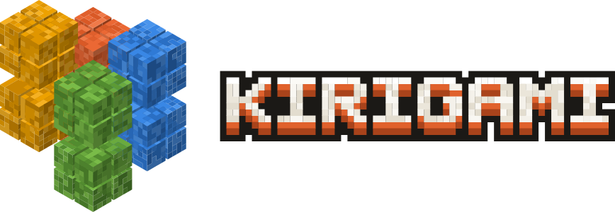

<h1 align="center">
  
</h1>

Kirigami is a Paper 26.3 fork that ticks the world on all CPU cores while behaving like vanilla Minecraft. Vanilla behaviour comes first, Paper's own gameplay changes are switched back to vanilla by default, and plugins keep working.

## The idea

A Minecraft server ticks the whole world on one thread, and with 64 spread-out players that tick took about 80 ms on Paper, well over the 50 ms that 20 ticks per second allow. Most of that work happens in places far apart from each other, so it can run at the same time if the world is cut into pieces that cannot touch within one tick.


## How it works



- **Region ticking:** the world is divided into cells of 8×8 chunks, coloured like a 2×2 checkerboard. Cells of the same colour are far enough apart that nothing in one can affect another within a tick, so they run in parallel. Each phase (entities, random block ticks, block entities, and scheduled block and fluid ticks if switched on) runs colour by colour.
- **Redstone:** with `parallel.phases.scheduled-ticks: true` (off by default, see [Differences from vanilla](#differences-from-vanilla)), scheduled ticks (repeaters, comparators, observers, water, lava) run in their cells in vanilla order. Ticks that lie within 64 blocks of each other form a group, and groups that reach into more than one cell run serially in vanilla order, so machines on a cell border behave exactly as in vanilla. Vanilla redstone, Alternate Current and Eigencraft (`redstone-implementation` in `paper-world-defaults.yml`) all tick in parallel.
- **Vanilla order where it matters:** shared state (scheduled ticks, entity section moves, block entity lists) is locked or deferred and applied in vanilla order. Block entity clusters that cross a cell border (hopper chains, sorters) run serially. Each cell has its own random sources.
- **Parallel spawning:** spawn positions are searched in parallel without side effects, then committed in vanilla order. Searches whose area changed in the meantime are redone.
- **Entity tracker and villagers:** sending entity updates to players and villager AI run in parallel. Job-site and bed claims are atomic, and villagers that are trading stay on the main thread.
- **World pause:** when a worker needs a blocking chunk load, or plugin code runs (events with listeners, custom mob goals), the other workers pause between two items. The plugin code and the load see a world where nothing else runs, as on Paper.


## Download

| Channel | Jar | Docker image |
|---|---|---|
| Latest stable release | [kirigami.jar](https://github.com/Quavon-dev/kirigami/releases/latest/download/kirigami.jar) | `ghcr.io/quavon-dev/kirigami:latest` |
| Newest build for one Minecraft version | from the [releases](https://github.com/Quavon-dev/kirigami/releases) | `ghcr.io/quavon-dev/kirigami:26.3` |
| One exact build | from the [releases](https://github.com/Quavon-dev/kirigami/releases) | `ghcr.io/quavon-dev/kirigami:26.3-4` |
| Every commit on `main` (untested) | [kirigami.jar](https://github.com/Quavon-dev/kirigami/releases/download/edge/kirigami.jar) | `ghcr.io/quavon-dev/kirigami:edge` |

Every jar comes with a `kirigami.jar.sha256` checksum. The jar is a Paperclip jar: on first start it downloads the official Minecraft server from Mojang and patches it locally.

Worlds cannot be moved back to an older Minecraft version. `latest` follows new Minecraft versions automatically, so pin the Minecraft version (for example `:26.3`) if you want to decide yourself when to update.

```bash
docker run -d --name kirigami -p 25565:25565 -e EULA=true -e MEMORY=8G -v kirigami-data:/data ghcr.io/quavon-dev/kirigami:26.3
```

`EULA=true` accepts the [Minecraft EULA](https://aka.ms/MinecraftEULA). `MEMORY` sets the heap size and `JAVA_OPTS` replaces the default G1 flags. The server data lives in `/data`; Kirigami's settings are in `/data/config/kirigami.yml`, and `-Dkirigami.…` flags in `JAVA_OPTS` override them.

### Setup script

`setup.sh` (macOS, Linux, WSL, Git Bash) and `setup.ps1` (Windows PowerShell) set up a server interactively. They look for a running Docker or Podman and a Java 25 install, then ask for the method, the EULA, the release channel, heap size and port. The plain setup verifies the jar against its `.sha256` file and writes a `start.sh` or `start.bat`.

```bash
curl -fsSLO https://raw.githubusercontent.com/Quavon-dev/kirigami/main/setup.sh && bash setup.sh
```

```powershell
irm https://raw.githubusercontent.com/Quavon-dev/kirigami/main/setup.ps1 -OutFile setup.ps1; powershell -ExecutionPolicy Bypass -File setup.ps1
```

## Building and running

Kirigami uses Paper's [paperweight](https://github.com/PaperMC/paperweight) fork layout: the repository contains only Kirigami's own changes, applied on top of a pinned Paper commit (`paperRef` in `gradle.properties`). Java 25 is required.

```bash
./gradlew applyAllPatches
./gradlew :kirigami-server:createPaperclipJar
java -jar kirigami-server/build/libs/kirigami-paperclip-26.3.local-SNAPSHOT.jar --nogui
```

Use Paper's recommended G1 flags (see `testing/scripts/bench.sh`). Generational ZGC performed worse in tests.

## Repository layout

| Path | Content |
|---|---|
| `kirigami-server/minecraft-patches/features/` | Changes to Minecraft code, one patch per feature |
| `kirigami-server/paper-patches/features/` | Changes to Paper's own server code |
| `kirigami-server/src/main/java/kirigami/` | Kirigami's own code (region ticking, parallel spawning, world pause, bench tools) |
| `kirigami-server/build.gradle.kts.patch`, `kirigami-api/build.gradle.kts.patch` | Build changes on top of Paper's build files |
| `testing/` | Test scripts, datapacks, the probe plugin and all recorded results |
| `docker/` | Dockerfile and entrypoint of the container image |
| `.github/workflows/build.yml` | Builds every push; publishes releases, the `edge` pre-release and the Docker images |
| `.github/workflows/update-paper.yml`, `.github/scripts/update-paper.sh` | Weekly Paper update: rebuilds the patches, checks parity and opens a pull request or an issue |
| `docs/` | Images for this README |

After `applyAllPatches`, edit the generated sources (`kirigami-server/src/minecraft/java` for Minecraft code, `paper-server/` for Paper code), commit there, and run `./gradlew rebuildAllServerPatches` to update the patch files.

## Releases

Versions are `<Minecraft version>-<build>`, for example `26.3-4`; the build number starts again at 1 for each Minecraft version. Pushing a tag such as `v26.3-4` builds the release, attaches the jar and checksum, and publishes the Docker tags `26.3-4` and `26.3`, plus `latest` if the tag is on `main`. Every push to `main` updates the `edge` pre-release and the `edge` image. Nothing is published unless the vanilla parity check passes.

## Settings

Kirigami writes `config/kirigami.yml` on first start, next to Paper's configuration files. A JVM flag (`-Dkirigami.…`) overrides the value from the file, so existing start scripts keep working. Defaults are the recommended values.

| `config/kirigami.yml` | JVM flag | Default | Meaning |
|---|---|---|---|
| `parallel.region-ticking` | `kirigami.regionTicking` | `true` | Parallel region ticking |
| `parallel.phases.entities`, `.random-ticks`, `.block-entities`, `.entity-tracker` | `kirigami.region.entities`, `.chunks`, `.blockEntities`, `.tracker` | `true` | Switch single parallel phases |
| `parallel.phases.scheduled-ticks` | `kirigami.region.scheduledTicks` | `false` | Parallel scheduled block and fluid ticks; faster redstone, but not fully vanilla order (see below) |
| `parallel.spawning` | `kirigami.parallelSpawning` | `true` | Parallel spawn search |
| `parallel.region-workers`, `parallel.spawn-workers` | `kirigami.regionWorkers`, `kirigami.tickWorkers` | `-1` (cores − 1) | Worker threads; with 0 the plain serial code paths run |
| `parallel.min-parallel-items`, `parallel.min-speculative-jobs` | `kirigami.minParallelItems`, `kirigami.minSpeculativeJobs` | `256`, `512` | Below these amounts a phase runs serially |
| `plugins.serial-with-plugins` | `kirigami.serialWithPlugins` | `false` | Disable parallelism whenever plugins are installed |
| `paper-behaviour.chest-delay`, `.pathfinding-backoff`, `.fluid-random-tick-fix`, `.raid-banner-griefing`, `.boat-rise-collision`, `.raid-omen-fix` | `kirigami.paper.chestDelay`, `.pathfindingBackoff`, `.fluidRandomTickFix`, `.raidBannerGriefing`, `.boatRiseCollision`, `kirigami.craftbukkit.raidOmenFix` | `false` | Restore Paper or CraftBukkit behaviour instead of vanilla |

Diagnostic settings exist only as JVM flags: `kirigami.checkReads`, `kirigami.readReach` and `kirigami.writeReach` report accesses outside a cell's reach, `kirigami.verifySpawning` and `kirigami.seedSalt` help debugging parallel spawning, and `kirigami.benchTools` enables the `/mtbench` benchmark command used by the scripts in `testing/`.

## Status command

`/kirigami` (permission `kirigami.command`, operators by default) shows whether each parallel phase is on, the number of worker threads, TPS and tick time, and per-tick averages of parallel and serial work, cell runs, spawn searches and world pauses. It also lists the five events or sources that paused the world most often, with the plugins that listen to them. `/kirigami reset` starts a new measurement, for example right before a farm or event you want to look at.

## Switching from Paper

Stop the Paper server, replace the jar and start Kirigami in the same folder. Worlds, plugins, plugin data and Paper's configuration files are used as they are; Kirigami only adds `config/kirigami.yml`. Plugins see the Paper API: Kirigami reports itself as compatible with the Paper brand, and `Bukkit.isPrimaryThread()` is true wherever plugin code runs.

- Event listeners, custom mob goals and scheduler tasks never run at the same time as other world code. An event fired from a parallel phase pauses the other workers first.
- If world pauses for plugin events and mob goals take more than half of a parallel phase's time (for example a `BlockPhysicsEvent` listener during heavy redstone), and the phase's last measured serial run was faster, that phase runs serially for the next 30 seconds instead of getting slower than Paper. A phase with many pauses that still beats its serial time stays parallel. A warning in the log and `/kirigami` show which event and plugin cause it.
- Command blocks and command block minecarts run serially, so commands from plugins and datapacks behave as on Paper.
- Settings that already differ from vanilla in an existing `paper-world-defaults.yml` or `spigot.yml` are kept; only new files get Kirigami's vanilla defaults.

`testing/scripts/compat.sh <run-name> <kirigami-jar> <paper-server-dir>` copies a Paper server, runs it on Kirigami with bench bots and the probe plugin, and fails if a plugin does not enable, plugin code overlaps or runs off-thread, or new errors appear. With `PAPER_JAR` set it runs the same folder on Paper first and only reports errors that Paper does not show.

## Differences from vanilla

- Paper's gameplay changes default to vanilla: activation ranges, entity collision limits, per-player mob caps, TNT limits, dupes and bedrock breaking (`unsupported-settings`), phantom rules, player cramming damage, beehive and villager retry delays, raid fixes. Paper's own exploit protections can be re-enabled in `config/paper-global.yml` and `config/paper-world-defaults.yml`.
- Update suppression does not crash the server: Paper's catch is kept, while vanilla would crash.
- Within one tick, entities in different cells tick colour by colour instead of in vanilla's global list order. Deterministic contraption tests and statistical farm tests show no measurable difference. Scheduled ticks run serially in vanilla order by default. With `parallel.phases.scheduled-ticks: true`, scheduled ticks within 64 blocks of each other run serially in vanilla order when their group spans a cell border; groups further apart run colour by colour. Command block and tripwire ticks keep the whole phase serial. This is not fully vanilla: ticks they schedule get sub-tick numbers in the order cells run, so repeaters scheduled by two distant ticks can later race differently; block events (pistons, note blocks) are queued in the order cells run; entities they create (dispensed arrows and TNT, falling blocks, drops) join after the colour finishes; and fire spread and dispenser slot choice use the cell's random source. Not tested: water or lava that breaks tripwire string is a fluid tick, so it does not keep the phase serial, and the hook update it causes can reach about 56 blocks, further than the 64-block grouping assumes for two ticks. Entities spawned during a parallel phase (for example TNT primed by an explosion) join the world after their cell's colour finishes, so explosions later in the same tick do not push them yet; long TNT chains can therefore end at a different point than in vanilla.

## Testing

| Script | Purpose |
|---|---|
| `testing/scripts/det.sh` | Deterministic contraptions across cell borders (hopper chains, observer clock, hopper race, item sorters, item pickup, minecart loop through four cells, piston race, furnace chain, piston duels on and off a cell border); `REDSTONE_IMPL` selects Alternate Current or Eigencraft |
| `testing/scripts/parity.sh` | Runs the deterministic contraptions on the official Minecraft server and on Kirigami with parallelism forced on, and fails on any difference; CI runs it on every push and pull request |
| `testing/scripts/lab.sh` | Lab benchmark (telegraph, TNT, grinder, item floor, fights, village, portal); `REDSTONE=1` adds 400 observer clocks in 16 machines above the lab; the lab's telegraph line crosses two cell borders and links about half of them into serial groups, so it measures a mixed case |
| `testing/scripts/compat.sh` | Runs a copied Paper server with its plugins on Kirigami and compares the log with Paper |
| `testing/scripts/farm.sh`, `farm-matrix.sh`, `farm_stats.py` | Statistical farm tests (`testing/farms/mtfarm`, `mtraid`, `mtportal`, `mtvillage`) against Fabric + Carpet vanilla |
| `testing/scripts/bench.sh` | Tick time benchmarks with bench bots, optional `SETUP` command file and `PLUGIN` jars |
| `testing/scripts/soak.sh` | Multi-hour stability run across all three dimensions with plugins |
| `testing/plugins/mtprobe` | Test plugin that detects overlapping or off-thread event calls |


Results are in `testing/results/`, open items in `BACKLOG.md`.

## Results


All numbers from an M2 Max; details and raw data in `testing/results/`.

### Earlier measurements (M2 Max, 64 spread-out bots)

| Setup | Tick time (median) |
|---|---|
| Vanilla behaviour, serial | ~90 ms |
| Fork, 2 / 4 / 8 / 12 cores (container limits) | 60 / 43 / 36 / 35 ms |
| 800 villagers in 8 villages, fork | ~46 ms (serial 123 ms, both with the mtprobe test plugin) |
| Same with LuckPerms, EssentialsX, WorldEdit, WorldGuard, CoreProtect, ViaVersion | ~62 ms on a busier machine, ~57 ms without plugins in the same session (plugins forcing serial: 123 ms) |

A single busy area (one farm or trading hall inside one cell) still runs on one thread; see `BACKLOG.md`.

## Contributing and support

Report bugs and differences from vanilla through the [issue templates](https://github.com/Quavon-dev/kirigami/issues/new/choose), ask questions in [Discussions](https://github.com/Quavon-dev/kirigami/discussions), and report security problems privately as described in [SECURITY.md](SECURITY.md). [CONTRIBUTING.md](CONTRIBUTING.md) explains the development setup, the patch workflow and the tests a change needs.

## License

Kirigami is based on [Paper](https://github.com/PaperMC/Paper) and licensed under the GNU General Public License v3.0, like Paper's server code. See [LICENSE.md](LICENSE.md). It is not affiliated with or supported by PaperMC; please report problems here, not to PaperMC.

---

<p align="center">
  <a href="https://quavon.de">
    <picture>
      <source media="(prefers-color-scheme: dark)" srcset="docs/images/quavon-banner-dark.svg">
      
    </picture>
  </a>
</p>
